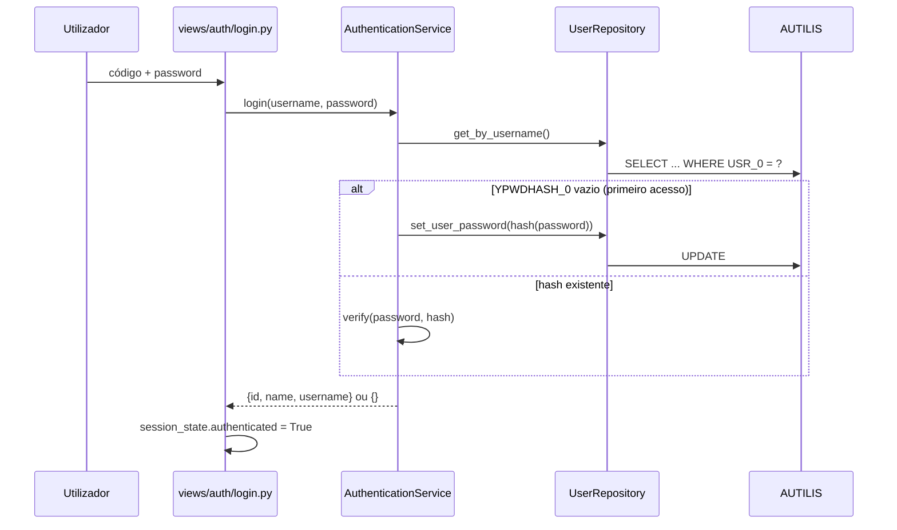

# Autenticação

Os utilizadores são os do Sage X3 (tabela `AUTILIS`). A password da aplicação é guardada
na coluna específica `YPWDHASH_0`, com hash **Argon2** (`pwdlib`).

## Estado de sessão

| Chave | Tipo | Descrição |
|---|---|---|
| `authenticated` | `bool` | Utilizador autenticado. |
| `user` | `str` | Código do utilizador (`USR_0`). |

Funções em [`gn_dashboard.ui.guards`](../referencia/ui.md):
`init_session_state()`, `is_authenticated()`, `require_authentication()` e `clear_authentication()`.

## Proteção das páginas

1. `app.py` só regista a página de login enquanto o utilizador não estiver autenticado.
2. Cada página protegida chama `require_authentication()` no início, como segunda barreira.

!!! warning "Primeiro acesso"
    Um utilizador do Sage X3 sem `YPWDHASH_0` fica com password definida pela **primeira**
    pessoa que fizer login com esse código. Recomenda-se definir passwords iniciais
    (ou restringir utilizadores, por exemplo com `ENAFLG_0 = 2`) antes de abrir o acesso.
