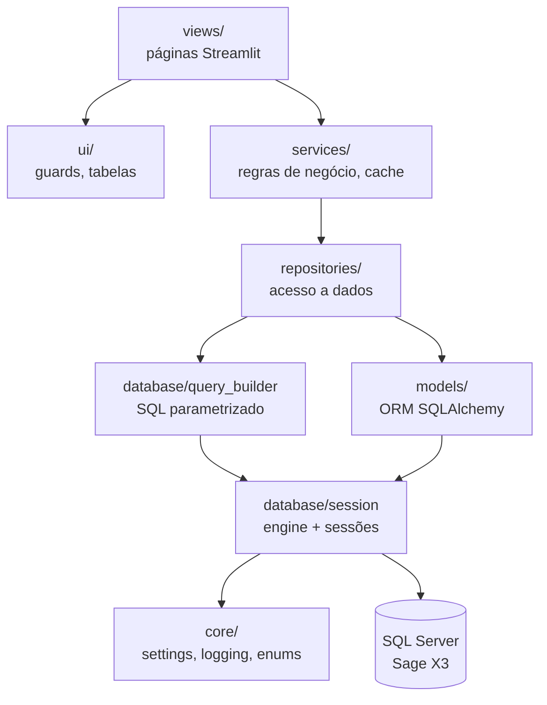

# Visão geral

A aplicação está organizada em camadas com dependências num só sentido: cada camada só
conhece as camadas abaixo dela.

| Camada | Responsabilidade | Pode usar Streamlit? |
|---|---|---|
| `views` | Interface: formulários, filtros, tabelas. Sem SQL. | sim |
| `ui` | Componentes reutilizáveis de interface e proteção de páginas. | sim |
| `services` | Orquestração e regras de negócio; cache com `st.cache_data`. | só cache e mensagens |
| `repositories` | Uma classe por entidade; devolve tipos simples ou modelos ORM. | não |
| `database` | Engine, sessões, construção e execução de SQL. | não |
| `models` | Mapeamento ORM das tabelas Sage X3. | não |
| `core` | Configuração, logging e constantes. | só para ler `st.secrets` |

## Duas formas de aceder aos dados

1. **ORM SQLAlchemy** (`models/` + `select()`): usado para utilizadores (`AUTILIS`), onde
   é preciso ler e gravar o objeto completo.
2. **QueryBuilder** (`database/query_builder.py`): SQL construído a partir de dicionários,
   com valores sempre parametrizados. É usado em agregações e leituras simples (faturas, clientes, países).

!!! warning "Nomes de tabelas e colunas"
    O `QueryBuilder` interpola nomes de tabelas, colunas, JOINs e `ORDER BY` diretamente no SQL.
    Estes valores **nunca** devem vir de input do utilizador; só os *valores* são parametrizados.

## Ligação à base de dados

`get_database_manager()` cria um único `DatabaseManager` por processo (com `lru_cache`)
na primeira utilização, e não no import. Assim, importar módulos (em testes, ou para
gerar documentação) não abre ligações.
