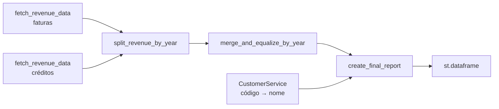

# Relatórios

## Receita anual por cliente

**Página:** `views/reports/annual_revenue_per_customer.py`
**Serviço:** [`AnnualRevenueService`](../referencia/services.md)

### Filtros

- Número de anos (3 a 5), terminando no ano corrente.

### Origem dos dados

Tabela `SINVOICE`, agregada por ano contabilístico (`YEAR(ACCDAT_0)`) e cliente (`BPR_0`):

| Condição | Significado |
|---|---|
| `INVTYP_0 = 1` / `= 2` | Faturas / notas de crédito (`Chapter645`) |
| `REVCANSTA_0 = 0` | Documentos não anulados |
| `ORIMOD_0 = 5` | Origem: módulo de vendas |

Os nomes dos clientes vêm de `BPCUSTOMER` (`BPCNUM_0`, `BPCNAM_0`).

### Processamento

A tabela final tem colunas em dois níveis: `Info` (`Customer`, `Name`) e, para cada ano,
`Amount_invoice`, `Amount_credit` e `Balance` (faturas − créditos).

As consultas ficam em cache durante **10 minutos** (`st.cache_data(ttl=600)`).
