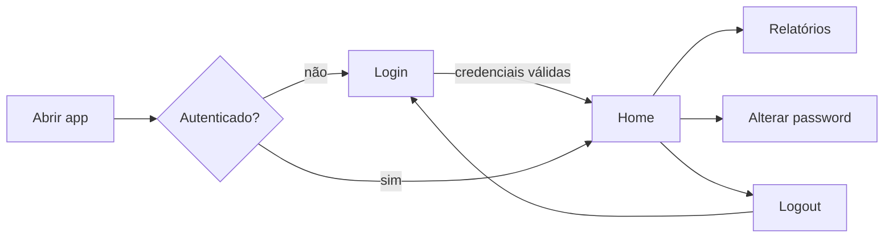

# Executar a aplicação

Execute sempre a partir da **raiz do projeto**: o Streamlit procura `.streamlit/` no diretório atual.

=== "uv"

    ```bash
    uv run streamlit run src/gn_dashboard/app.py
    # ou, com o comando instalado pelo pacote:
    uv run gn-dashboard
    ```

=== "venv ativo"

    ```bash
    streamlit run src/gn_dashboard/app.py
    gn-dashboard
    python -m gn_dashboard
    ```

Os argumentos extra são passados ao Streamlit, por exemplo `gn-dashboard --server.port 8502`.

## Fluxo de navegação


