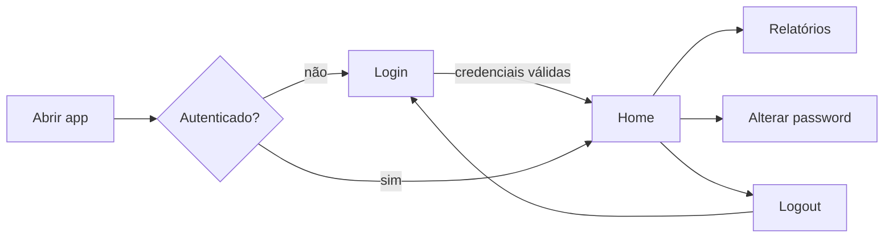

# Executar a aplicação

Execute sempre a partir da **raiz do projeto**: o Streamlit procura `.streamlit/` no diretório atual.

=== "uv"

    ```bash
    uv run streamlit run src/gn_dashboard/app.py
    # ou, com o comando instalado pelo pacote:
    uv run gn-dashboard
    ```

=== "venv ativo"

    ```bash
    streamlit run src/gn_dashboard/app.py
    gn-dashboard
    python -m gn_dashboard
    ```

Os argumentos extra são passados ao Streamlit, por exemplo `gn-dashboard --server.port 8501`.

## Executar como serviço do Windows (NSSM)

No servidor, a aplicação corre como serviço do Windows gerido pelo
[NSSM](https://nssm.cc/) (_Non-Sucking Service Manager_). O NSSM arranca o processo
no boot, reinicia-o se terminar e redireciona a saída para ficheiros de log.

### Pré-requisitos

- Projeto instalado no servidor com o ambiente virtual criado (ver [Instalação](instalacao.md)),
  em `C:\Programas_GN\dashboard` com `.venv\` lá dentro.
- `.streamlit\secrets.toml` preenchido (ver [Configuração](configuracao.md)).
- `nssm.exe` disponível (por exemplo em `C:\tools\nssm\nssm.exe` ou no `PATH`).
- Consola **PowerShell como Administrador**.

!!! tip "Use o Python do `.venv` diretamente"
O serviço não corre na sua sessão, por isso não tem o `PATH` nem o venv ativo.
Aponte o NSSM para `.venv\Scripts\python.exe` em vez de `uv run` ou `gn-dashboard`:
não depende de o `uv` estar instalado para a conta do serviço.

### Criar o serviço

Valores do servidor de produção (ajuste `$Nssm` ao local do `nssm.exe`):

```powershell
$Nssm    = "C:\Programas_GN\nssm-2.24\win64\nssm.exe"
$Service = "Dashboard_GN"
$App     = "C:\Programas_GN\dashboard"

# Executável e argumentos
& $Nssm install $Service "$App\.venv\Scripts\python.exe"
& $Nssm set $Service AppParameters "-m gn_dashboard --server.port 8501"

# Diretório de trabalho = raiz do projeto (obrigatório: é onde está .streamlit\)
& $Nssm set $Service AppDirectory $App

# Identificação
& $Nssm set $Service DisplayName "GN Dashboard (Streamlit)"
& $Nssm set $Service Description "Dashboard de relatórios Sage X3 - Garrafeira Nacional"
& $Nssm set $Service Start SERVICE_AUTO_START   # ou SERVICE_DELAYED_AUTO_START

# Saída do processo (stdout/stderr) com rotação
& $Nssm set $Service AppStdout "$App\logs\service_stdout.log"
& $Nssm set $Service AppStderr "$App\logs\service_stderr.log"
& $Nssm set $Service AppRotateFiles 1
& $Nssm set $Service AppRotateOnline 1
& $Nssm set $Service AppRotateBytes 10485760     # roda aos 10 MB

# Reiniciar automaticamente se o processo terminar
& $Nssm set $Service AppExit Default Restart
& $Nssm set $Service AppRestartDelay 5000        # espera 5 s antes de reiniciar

# Encoding UTF-8 na saída do Python (acentos nos logs)
& $Nssm set $Service AppEnvironmentExtra PYTHONIOENCODING=utf-8 PYTHONUTF8=1

& $Nssm start $Service
```

Em alternativa, `nssm install Dashboard_GN` (sem mais argumentos) abre uma janela onde
os mesmos campos podem ser preenchidos: separadores _Application_ (Path, Startup
directory, Arguments), _Details_, _I/O_ e _Exit actions_.

!!! note "Logs da aplicação vs. logs do serviço"
A aplicação continua a escrever os seus logs em `logs\app_info.log` e
`logs\app_error.log`. Os ficheiros `service_stdout.log` / `service_stderr.log`
captam a saída do Streamlit (arranque, URL, tracebacks não tratados), úteis
quando o serviço não arranca.

### Migrar o serviço existente (versão 0.1 → 0.2)

Até à versão 0.1 o serviço `Dashboard_GN` estava configurado assim:

| Campo NSSM        | 0.1 (antigo)                                            | 0.2 (atual)                                          |
| ----------------- | ------------------------------------------------------- | ---------------------------------------------------- |
| Path              | `C:\Programas_GN\dashboard\.venv\Scripts\streamlit.exe` | `C:\Programas_GN\dashboard\.venv\Scripts\python.exe` |
| Startup directory | `C:\Programas_GN\dashboard`                             | `C:\Programas_GN\dashboard` (igual)                  |
| Arguments         | `run main.py`                                           | `-m gn_dashboard --server.port 8501`                 |

Na 0.2 o `main.py` da raiz deixou de existir (passou a `src/gn_dashboard/app.py`), por isso
a configuração antiga **deixa de arrancar**. Com `-m gn_dashboard` o caminho do `app.py` é
resolvido pelo próprio pacote, independentemente da estrutura de pastas.

Passos, em PowerShell como Administrador:

```powershell
nssm stop Dashboard_GN

cd C:\Programas_GN\dashboard
git pull
uv sync --no-dev          # ou: .venv\Scripts\pip install -r requirements.txt
                          # (instala o pacote gn_dashboard em modo editável)

nssm set Dashboard_GN Application "C:\Programas_GN\dashboard\.venv\Scripts\python.exe"
nssm set Dashboard_GN AppParameters "-m gn_dashboard --server.port 8501"
nssm set Dashboard_GN AppDirectory "C:\Programas_GN\dashboard"

nssm start Dashboard_GN
nssm status Dashboard_GN    # deve devolver SERVICE_RUNNING
```

Antes de alterar o serviço pode validar o arranque manualmente (com o serviço parado,
para a porta estar livre):

```powershell
cd C:\Programas_GN\dashboard
.venv\Scripts\python.exe -m gn_dashboard --server.port 8501
```

Se aparecer o URL do Streamlit e a aplicação abrir no browser, termine com `Ctrl+C` e
aplique a configuração acima. Os restantes parâmetros da secção
[Criar o serviço](#criar-o-servico) (logs, reinício automático, encoding) podem ser
acrescentados ao serviço existente com os mesmos comandos `nssm set`.

### Conta do serviço

Por omissão o serviço corre como `LocalSystem`. Como a ligação ao SQL Server usa
autenticação SQL (`trusted_connection = "no"`), isto normalmente basta. Se usar
`trusted_connection = "yes"`, ou se preferir uma conta com menos privilégios, defina
uma conta de domínio com acesso à base de dados e permissões de leitura na pasta do
projeto e de escrita em `logs\`:

```powershell
& $Nssm set Dashboard_GN ObjectName "DOMINIO\svc_gndashboard" "password"
```

### Firewall

Para aceder a partir de outros postos, abra a porta usada pelo serviço:

```powershell
New-NetFirewallRule -DisplayName "GN Dashboard 8501" -Direction Inbound `
    -Protocol TCP -LocalPort 8501 -Action Allow
```

A aplicação fica disponível em `http://<servidor>:8501`.

### Gestão do serviço

| Ação                      | Comando                               |
| ------------------------- | ------------------------------------- |
| Estado                    | `nssm status Dashboard_GN`            |
| Iniciar                   | `nssm start Dashboard_GN`             |
| Parar                     | `nssm stop Dashboard_GN`              |
| Reiniciar                 | `nssm restart Dashboard_GN`           |
| Editar configuração (GUI) | `nssm edit Dashboard_GN`              |
| Ver um parâmetro          | `nssm get Dashboard_GN AppParameters` |
| Remover                   | `nssm remove Dashboard_GN confirm`    |

Também pode ser gerido em `services.msc` ou com `Get-Service` / `Restart-Service Dashboard_GN`.

### Atualizar a aplicação

O serviço bloqueia os ficheiros do `.venv`, por isso pare-o antes de atualizar:

```powershell
nssm stop Dashboard_GN
cd C:\Programas_GN\dashboard
git pull
uv sync --no-dev          # ou: .venv\Scripts\pip install -r requirements.txt
nssm start Dashboard_GN
```

Alterações apenas em `.streamlit\secrets.toml` ou `config.toml` também requerem
`nssm restart Dashboard_GN`.

### Resolução de problemas

- **Serviço fica em `SERVICE_PAUSED` ou reinicia em ciclo** — veja
  `logs\service_stderr.log`; a causa mais comum é `AppDirectory` errado (o Streamlit
  não encontra `.streamlit\secrets.toml`) ou o pacote não instalado no `.venv`.
- **`ModuleNotFoundError: gn_dashboard`** — execute `uv sync` (ou `pip install -e .`)
  no servidor, com o mesmo `.venv` configurado no NSSM.
- **Erro de ODBC / login falhado** — confirme que o _ODBC Driver_ indicado em
  `secrets.toml` está instalado no servidor e, com `trusted_connection = "yes"`, que a
  conta do serviço tem acesso ao SQL Server.
- **Porta já em uso** — `Get-NetTCPConnection -LocalPort 8501` identifica o processo;
  altere `--server.port` com `nssm set Dashboard_GN AppParameters "..."`.

## Fluxo de navegação


